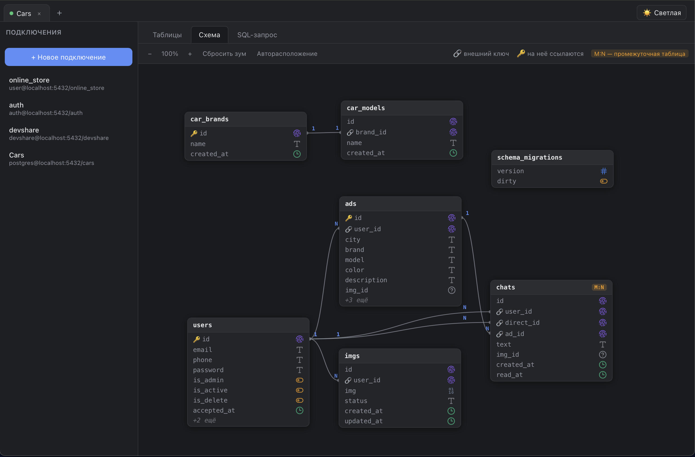
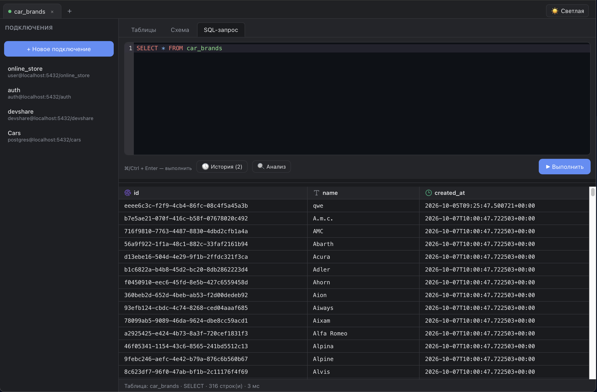
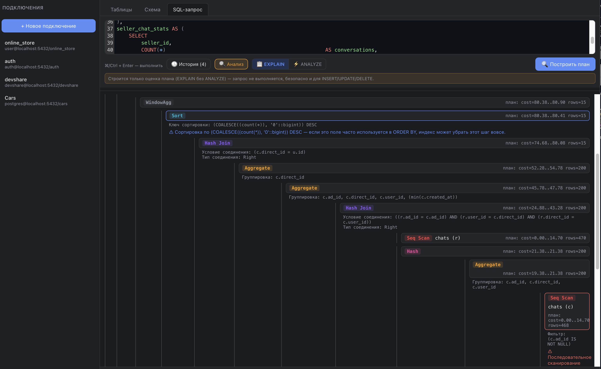
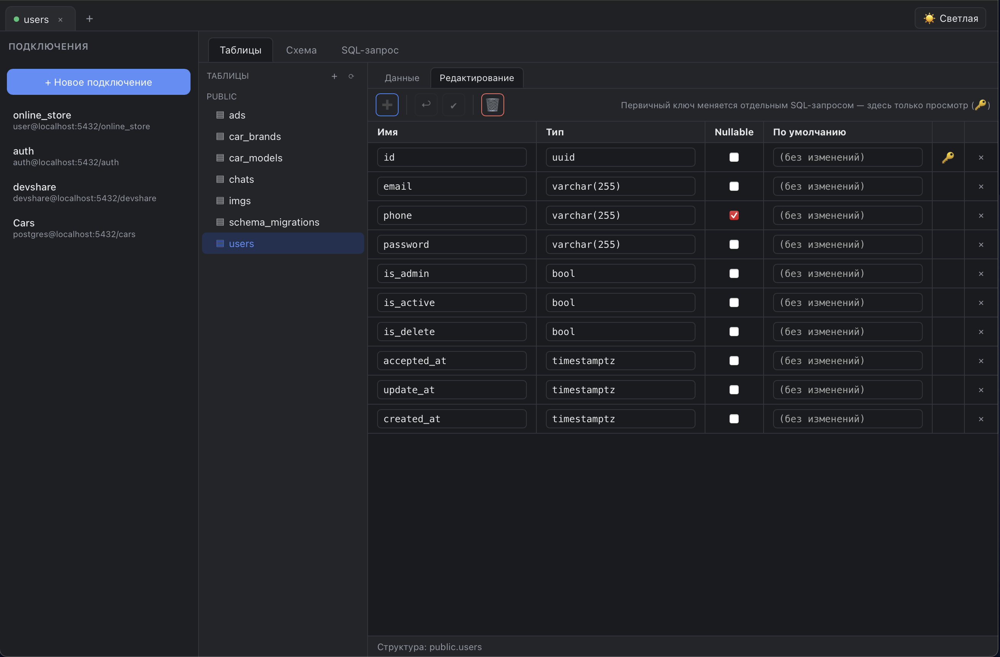

#   simpleDB

Лёгкий десктопный клиент для PostgreSQL под macOS. Построен на **Tauri 2 + Rust + React**.


## Возможности

- Подключение к PostgreSQL, сохранённые подключения
- Просмотр таблиц, вкладки как в браузере
- Выполнение SQL-запросов
- Редактирование данных прямо в таблице (изменения применяются одной транзакцией)
- Редактор структуры таблицы: добавление, удаление колонок, смена типа
- Создание и удаление таблиц (в том числе с `CASCADE`)
- Диаграмма схемы
- Светлая и тёмная тема


## Скриншоты


#### Связи таблиц


#### SQL-запросы


#### Анализ запроса


#### Редактирование таблиц



## Стек

- **Frontend:** React + TypeScript + Vite
- **Backend:** Rust, `tokio-postgres`, Tauri 2
- **UI:** без внешних UI-библиотек, тема через CSS-переменные

## Требования

1. **Node.js** 18+ и npm — https://nodejs.org или `brew install node`
2. **Rust** — https://rustup.rs
   ```bash
   curl --proto '=https' --tlsv1.2 -sSf https://sh.rustup.rs | sh
   ```
3. **Xcode Command Line Tools**
   ```bash
   xcode-select --install
   ```

Tauri CLI устанавливается как dev-зависимость проекта, отдельно ставить не нужно.

## Быстрый старт

```bash
git clone https://github.com/maxim-shishkov/simpleDB.git
cd simpledb
npm install
npm run tauri dev
```

Откроется окно приложения. Изменения во фронтенде подхватываются сразу, Rust-код пересобирается автоматически.

## Сборка (.app / .dmg)

```bash
npm run tauri build
```

Результат:

```
src-tauri/target/release/bundle/macos/simpleDB.app
src-tauri/target/release/bundle/dmg/simpleDB_0.1.0_<arch>.dmg
```

Сборка под конкретную архитектуру:

```bash
rustup target add aarch64-apple-darwin x86_64-apple-darwin

npm run tauri build -- --target aarch64-apple-darwin      # Apple Silicon
npm run tauri build -- --target x86_64-apple-darwin       # Intel
npm run tauri build -- --target universal-apple-darwin    # оба сразу
```

> **Gatekeeper.** Приложение не подписано сертификатом Apple Developer, поэтому при
> первом запуске macOS покажет предупреждение. Откройте **Системные настройки →
> Конфиденциальность и безопасность → Всё равно открыть** либо выполните:
> ```bash
> xattr -cr "simpleDB.app"
> ```

## Использование

### Редактирование данных

На вкладке «Таблицы» над данными есть тулбар:

| Кнопка | Действие |
|---|---|
| ✏️ Редактировать | Включает режим редактирования (нужен первичный ключ у таблицы) |
| ➕ | Добавляет пустую строку внизу |
| 🗑 | Помечает выбранные строки на удаление |
| ↩ | Отменяет все несохранённые изменения |
| ✔ Отправить (N) | Применяет изменения одной транзакцией |

Изменения выполняются как `BEGIN` → `INSERT`/`UPDATE`/`DELETE` → `COMMIT`. При любой ошибке выполняется `ROLLBACK`, и ничего не применится наполовину. Двойной клик по ячейке в режиме редактирования открывает инлайн-редактор.

Цвета: изменённые ячейки обведены рамкой, новые строки зелёные, изменённые жёлтые, помеченные на удаление красные и зачёркнуты.

### Структура таблицы

Переключатель **Данные / Структура** позволяет:

- добавлять и удалять колонки;
- менять тип (`ALTER COLUMN ... TYPE ... USING ...::новый_тип`), `NULL` и значение по умолчанию;
- переименовывать колонки.

Все изменения применяются одной транзакцией: сначала `DROP COLUMN`, затем `ADD COLUMN`, затем `TYPE`/`NULL`/`DEFAULT`, переименование в самом конце. Первичный ключ в редакторе доступен только для просмотра. Для его изменения используйте SQL-запрос.

### Создание и удаление таблиц

- **+** в заголовке дерева таблиц открывает окно создания таблицы (колонки, типы, `NOT NULL`, PK, `DEFAULT`).
- **🗑** рядом с таблицей удаляет её, с опциональным `CASCADE`.

## Хранение данных и безопасность

Сохранённые подключения, включая пароли, хранятся локально в файле рядом с приложением. Не передавайте этот файл другим людям и не добавляйте его в git. Для рабочих баз данных используйте отдельного пользователя с ограниченными правами.

## Лицензия

[MIT](LICENSE)